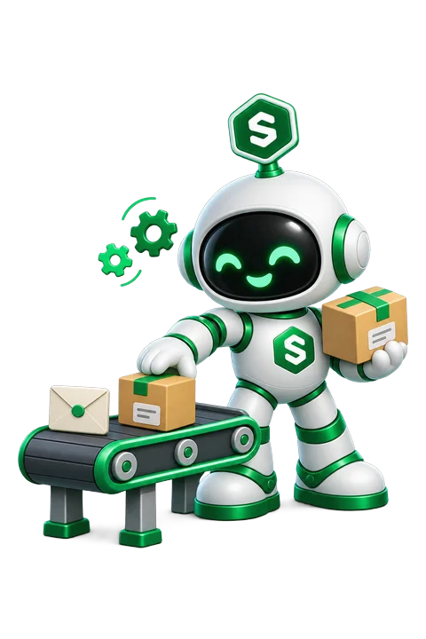

A worker is a process that keeps running beside your app: a Laravel queue worker, Horizon, Sidekiq, Celery, or a Node script that consumes a queue. It runs from your app's code, with its environment variables and volumes, in its own container.

```bash
php artisan queue:work --tries=3
```

## Workers or cron jobs

| | Workers | [Cron jobs](/apps/cron-jobs) |
| --- | --- | --- |
| Runs | All the time | On a schedule |
| When it exits | Restarted | The run is recorded and it waits for the next one |
| Where | Its own container | Inside the app's container |
| Good for | Queues, consumers, schedulers like `schedule:work` | Cleanups, reports, syncs |

## Before you start

- The app has been deployed at least once. A worker starts from the app's running version.
- The app's server runs agent **2.1.55** or later. Update it from the server's **Settings** if Symplax asks you to.
- The server is online.

## Add a worker

<Steps>
  <Step title="Open Workers">
    Open your app and go to the **Workers** tab. Click the **+** button.
  </Step>
  <Step title="Name it">
    Use lowercase letters, numbers and dashes, like `queue` or `emails`. The name cannot be changed later.
  </Step>
  <Step title="Enter the start command">
    Type the command, or pick one of the examples. It runs with `sh -c` from your app's working directory, the same way its own start command does.
  </Step>
  <Step title="Create it">
    Click **Create Worker**. Symplax starts it on your server and shows its status.
  </Step>
</Steps>

An app can have up to 10 workers.

## How workers run

Each worker is a separate container started from your app's current image.

- It gets the app's environment variables and volumes, and the same memory limit as the app.
- It joins your server's private network, so it reaches your managed databases the same way the app does.
- If it exits, it is restarted automatically.
- On every deploy and rollback, each worker moves to the new version, picking up new code and changed variables. A worker whose command, image and variables did not change is left running.
- Restarting the app restarts its workers. Removing the app removes them.

## Status and logs

Each worker card shows one of these:

| Status | Meaning |
| --- | --- |
| Running | The process is up. |
| Crashing | It keeps exiting with an error and being restarted. The card shows its last lines of output and how many times it restarted. |
| Stopped | It exited and is not running. |
| Not started | Symplax has not started it on the server yet, for example because the server was offline. Click restart to start it. |

Click **Logs** for the worker's own output. It is separate from the app's runtime logs.

## Edit, restart or delete

- **Edit** changes the command. The worker is restarted with it.
- **Restart** restarts that worker only.
- **Delete** stops and removes it.

<Note>
  Anyone on the app's team can see its workers. Adding, changing, restarting or deleting one needs Developer access or higher, because a worker runs with the app's secrets.
</Note>

## Good to know

- A worker should keep running. A command that finishes and exits, like a one-off script, will be restarted over and over and show as Crashing. Use a [cron job](/apps/cron-jobs) or a [release command](/apps/release-commands) for that.
- Each worker uses its own share of the server's memory and CPU, on top of the app. Check your server's headroom before adding several.
- Your app still needs a web process that answers HTTP. An app that is only a worker, with no web server, is not supported yet.
