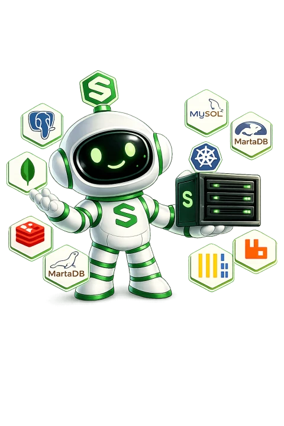

A Symplax database runs as its own container on one of your servers, next to your apps. Symplax generates the credentials, keeps the data on a persistent volume, and gives you a connection string to use.

## Engines and versions

| Engine | Versions you can choose | Default |
| --- | --- | --- |
| PostgreSQL | 18, 17, 16, 15 | 15 |
| MySQL | 9, 8.4, 8.0 | 8.4 |
| MariaDB | 12, 11, 10 | 11 |
| MongoDB | 8, 7, 6 | 7 |
| Redis | 8, 7 | 7 |
| Valkey | 9, 8, 7 | 8 |
| ClickHouse | 24 | 24 |

<Warning>
You choose the version when you create the database, and you cannot change it afterwards. A newer engine version refuses an older data directory, so moving to a new version means creating a new database and moving your data across.
</Warning>

<Note>
PostgreSQL 18 and MySQL 9 need server agent 2.1.46 or newer. If your server runs an older agent, Symplax refuses to create them and tells you to update the agent or pick an older version.
</Note>

## Create a database

<Steps>
  <Step title="Open Databases">
    Click **Databases** in the sidebar, then **Add Database**.
  </Step>
  <Step title="Fill in the form">
    - **Database name**: a name for the database, for example `my-database`.
    - **Server**: the server the database runs on. Pick the server your app runs on.
    - **Engine** and **Version**.
    - **Inject into app** (optional): an app that should get the connection string. See [Connect a database to an app](#connect-a-database-to-an-app).
  </Step>
  <Step title="Create it">
    Click **Create Database**. Symplax pulls the image, creates the container and runs health checks. The database shows as **Running** when it is ready.
  </Step>
</Steps>

You do not set a username or password. Symplax generates a random password for every database and stores it encrypted.

## Where your data lives

Each database keeps its data on a Docker volume on your server. The data survives restarts of the container and of the server. Stopping a database from **Settings** keeps all of its data, and **Start Database** brings it back.

**Delete Database** in **Settings** removes the container and its volume. This deletes all of the data and cannot be undone. Take a [backup](/databases/backups) and download it first if you might need it.

## Connection details

Open a database to see **Connection Details** on its **Overview** tab.

- **APP URL (internal)**: use this inside an app deployed on the **same server**. It points at the database's container name on Symplax's private network, so it only works from that server. While public access is off, it is the first thing shown.
- **HOST**, **PORT** and **URL**: the public address and connection string, for your laptop or tools like TablePlus, pgAdmin or DBeaver. They appear only while [public access](/databases/public-access) is on, because the port is closed to the internet otherwise.

The database name, username and password are shown too.

<Warning>
Do not use the public URL inside an app on the same server. Apps on that server cannot reach the database through the server's public IP. Use the internal URL instead.
</Warning>

**Quick Connect** on the same tab shows ready-to-copy snippets for common clients, such as Prisma, `pg`, `psycopg2` and `ioredis`. They use the address you can actually reach: the internal one while public access is off.

<Note>
Managed PostgreSQL accepts SSL connections, with a self-signed certificate made for each database. SSL is available, not required, so an app that does not ask for it connects as before.

Because the certificate is self-signed, a client that verifies certificates rejects it. Tell it to use SSL without verifying:

- Node.js `pg`: `ssl: { rejectUnauthorized: false }`, or `?sslmode=no-verify` on the URL. With `?sslmode=require`, `pg` verifies the certificate and refuses it.
- Prisma, psql, Python and most other clients: `?sslmode=require` works as is.

MySQL 8.4 and later and MariaDB 11 and later accept SSL the same way. Redis, Valkey, MongoDB, ClickHouse and MariaDB 10 do not use SSL.
</Note>

### Who can see the password

The password and both connection URLs are shown only to:

- the owner of the workspace,
- team admins,
- the person who created the database, while their role still lets them manage it.

Everyone else with access to the database sees the host, port and database name, and can still use the database through the dashboard. API keys need the `secrets:read` scope to read a password.

## Connect a database to an app

Symplax writes the connection string into an app's environment variables for you, with the address that works from where the app runs. You can do it from four places:

- **The database page**: **Connect to an app** is the first card on the **Overview** tab. Select the app and click **Connect**.
- **The app**: in its **Variables** tab, click **Connect Database**. See [Environment variables](/apps/environment-variables#connect-a-database).
- **A new app**: when you deploy from a Git repository, pick a database under **Database** in the last step.
- **A new database**: pick the app in **Inject into app** when you create it.

The variable name depends on the engine:

| Engine | Variable |
| --- | --- |
| PostgreSQL | `DATABASE_URL` |
| MySQL, MariaDB | `MYSQL_URL` |
| MongoDB | `MONGODB_URL` |
| Redis, Valkey | `REDIS_URL` |
| ClickHouse | `CLICKHOUSE_URL` |

An app on the same server as the database gets the internal URL. An app on a different server gets the public URL, so the database's [public access](/databases/public-access) must be on. With public access off, Symplax refuses to connect an app on another server and tells you why, because that app could not reach the database.

<Note>
Connecting replaces a variable with the same name if the app already has one. Redeploy the app afterwards so it picks up the new value.
</Note>

### Apps that cannot reach the database

Under **Connect to an app**, Symplax lists the apps that hold this database's address. If an app holds an address it cannot reach from where it runs, its row shows a warning:

- **It cannot reach the database at the address it has**: for example, an app on the same server using the public address. Click **Fix** to give it the internal address, then redeploy the app.
- **It is on another server and public access is off**: turn public access back on, or move the app or the database so they share a server.

Turning public access off while apps on other servers use it asks you to confirm first, and names those apps.

## How many databases you can have

| Plan | Databases |
| --- | --- |
| Free | 2 |
| Pro | 5 |
| Team | Unlimited |

The limit counts every database you have created, across all your servers. Deleting a database frees its slot. See [Plans](/billing/plans) for everything else each plan includes.

## Next steps

<CardGroup cols={3}>
  <Card title="Console" icon="terminal" href="/databases/console">
    Browse tables, keys and documents from the dashboard.
  </Card>
  <Card title="Backups" icon="box-archive" href="/databases/backups">
    Back up on demand or on a schedule, and restore.
  </Card>
  <Card title="Public access" icon="lock-open" href="/databases/public-access">
    Connect from your laptop or another host.
  </Card>
</CardGroup>
